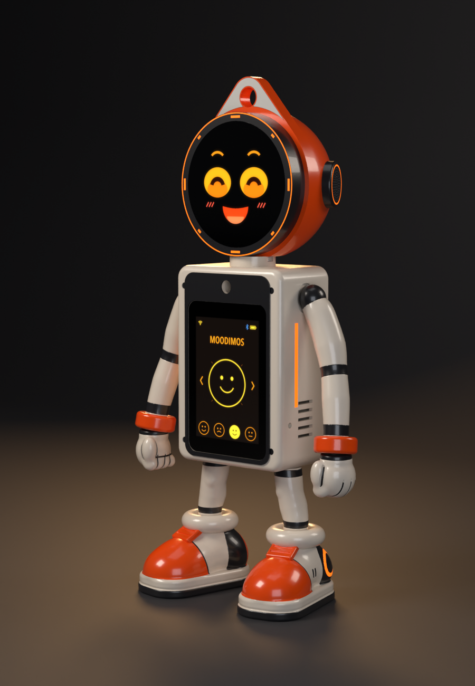

# MoodiMOS

**Français.** Un petit robot de bureau qui a de l'humeur, d'environ 32 cm. Sa tête est un écran rond de 2,1 pouces
posé sur un cou magnétique ; son torse porte un écran de 3,5 pouces avec l'heure, les mesures de la pièce et le jeu
« Devine l'animal ». Deux cartes ESP32-S3, des pièces imprimées en 3D, une alimentation USB-C. Le robot parle et
comprend le français.

**English.** A small desk robot with moods, about 32 cm tall. Its head is a round 2.1-inch screen on a magnetic neck;
its torso carries a 3.5-inch screen with the time, room readings and a guessing game. Two ESP32-S3 boards, 3D-printed
parts, USB-C power. The robot itself speaks and understands French.

## Dossiers / Folders

- [**francais/**](francais/) : dossier de fabrication en français.
- [**english/**](english/) : build package in English, with translated file names.

La notice illustrée, étape par étape, est sur Instructables ; ce dépôt contient les fichiers dont elle parle.

The illustrated step-by-step guide is on Instructables; this repository holds the files it refers to.

Chaque dossier est complet : programmes, pièces à imprimer, CAO, schémas. Travaillez dans l'un des deux sans mélanger
leurs fichiers.

Each folder is complete on its own: firmware, printable parts, CAD and diagrams. Work in one of them and do not mix
their files.

## Avant de commencer

MoodiMOS est un projet personnel partagé gratuitement. Claude, l'IA d'Anthropic, a aidé à le développer et a écrit le
code du garde-fou de la conversation à partir des règles de l'auteur ; Codex a participé à la relecture. Les fichiers
décrivent le montage et les essais de l'auteur et sont fournis tels quels, sans garantie. Vérifiez les dimensions sur
vos composants et contrôlez le câblage avant la première mise sous tension. Gardez les petites pièces et les aimants
hors de portée des jeunes enfants. La conversation avec une IA est facultative et expérimentale : si un enfant
l'utilise, activez le garde-fou décrit à l'étape 15 et restez à ses côtés.

## Before you start

MoodiMOS is a personal project shared free of charge. Claude, Anthropic's AI, helped develop it and wrote the
conversation safeguard from the author's rules; Codex helped review it. The files describe the author's build and
tests and are provided as is, without warranty. Check dimensions against your components and check the wiring before
the first power-up. Keep small parts and magnets away from young children. AI conversation is optional and
experimental: if a child uses it, enable the safeguard described in Step 15 and stay with them.

## Licence / License

MoodiMOS, par / by shredermann-hash. Programmes, CAO, pièces à imprimer, schémas et documentation sous licence
[CC BY-NC-SA 4.0](https://creativecommons.org/licenses/by-nc-sa/4.0/deed.fr) : vous pouvez fabriquer, modifier et
partager, en citant MoodiMOS, sans usage commercial, et sous la même licence. Texte complet : [LICENSE](LICENSE).

Firmware, CAD, printable parts, diagrams and documentation are licensed under
[CC BY-NC-SA 4.0](https://creativecommons.org/licenses/by-nc-sa/4.0/): you may build, modify and share them, with
attribution, for non-commercial purposes, under the same licence. Full text: [LICENSE](LICENSE).
